# Let It Snow - Architecture

**English** | [Русский](./architecture_RU.md)

Version: 3.0.0
Updated: October 30, 2026

## Architecture diagram

```mermaid
graph TB
    subgraph Browser["🌐 Browser Environment"]
        WebPages["📄 Web Pages"]
    end

    subgraph ContentScript["🎬 Content Script Layer"]
        MainContent["content/index.js<br/>Main orchestrator"]
        
        subgraph Renderers["🎨 Rendering Engines"]
            WebGPU["webgpu-renderer.js<br/>Primary renderer"]
            Fallback2D["fallback-2d-renderer.js<br/>Canvas fallback"]
            ThreeD["three-d-renderer.js<br/>Optional WebGL2 3D renderer"]
            Shader["shader.wgsl<br/>GPU shader"]
            GIFLayer["gif-layer.js<br/>GIF overlay support"]
        end

        subgraph Graphics["🧩 Graphics Layer"]
            AtlasManager["atlas-manager.js<br/>Glyph/sentence atlases"]
            UniformBuffer["uniform-buffer.js<br/>Uniform buffer manager"]
        end

        subgraph Physics["🧪 Physics Layer"]
            SnowPhysics["snow-physics.js<br/>Shared forces + velocity"]
            TimeStep["time-step.js<br/>Fixed-step clocks"]
            CollisionHandler["collision-handler.js<br/>Soft collisions"]
            WindField["wind-field.js<br/>Shared wind + vortices"]
        end
        
        subgraph Utils["🛠️ Utilities"]
            BgMonitor["background-monitor.js<br/>Background detection"]
            ColorUtils["color-utils.js<br/>Color processing"]
            GlyphUtils["glyph-utils.js<br/>Text rendering"]
            GlyphQuality["glyph-quality-estimator.js<br/>Atlas cell size estimator"]
            ViewportUtils["viewport-utils.js<br/>Stable viewport resolver"]
            SizeUtils["size-utils.js<br/>Viewport/canvas size"]
            CircularCursor["circular-cursor.js<br/>Shared circular index"]
        end
    end

    subgraph PopupUI["⚙️ Extension Popup"]
        PopupMain["popup.js<br/>Main logic"]
        PopupHTML["popup.html<br/>UI structure"]
        PopupCSS["popup.css<br/>Styling"]
        Settings["settings.js<br/>Settings manager"]
        UIControllers["ui-controllers.js<br/>UI interactions"]
        Localization["localization.js<br/>i18n handler"]
        BuiltInPresets["presets/built-in-presets.js<br/>Seasonal preset templates"]
    end

    subgraph Storage["💾 Persistent Storage"]
        BrowserStorage["Browser Storage API<br/>Settings & State"]
    end

    subgraph Config["📋 Configuration"]
        Manifest["manifest.json<br/>Base config"]
        ManifestChrome["manifests/manifest.chrome.json"]
        ManifestEdge["manifests/manifest.edge.json"]
        ManifestFirefox["manifests/manifest.firefox.json"]
        LocaleEN["_locales/en/messages.json"]
        LocaleRU["_locales/ru/messages.json"]
    end

    subgraph Assets["🎨 Static Assets"]
        Icons["icons/*<br/>Extension icons"]
    end

    WebPages -->|Injected into| MainContent
    MainContent -->|Uses| WebGPU
    MainContent -->|Falls back to| Fallback2D
    MainContent -->|Optional 3D mode| ThreeD
    MainContent -->|Overlays| GIFLayer
    WebGPU -.->|Uses| Shader
    WebGPU -->|Uses| Graphics
    WebGPU -->|Uses| Physics
    Fallback2D -.->|Uses| Physics
    ThreeD -.->|Uses| Physics
    GIFLayer -.->|Uses| Physics
    GIFLayer -.->|Uses| WindField
    WebGPU -.->|Uses| WindField
    Fallback2D -.->|Uses| WindField
    WebGPU -.->|Uses| GlyphQuality
    MainContent -.->|Uses| Utils
    
    PopupMain -->|Manages| Settings
    PopupMain -->|Controls| UIControllers
    PopupMain -.->|Uses| Localization
    PopupMain -.->|Uses| BuiltInPresets
    Settings <-->|Read/Write| BrowserStorage
    MainContent -.->|Reads| BrowserStorage
    
    Localization -.->|Loads| LocaleEN
    Localization -.->|Loads| LocaleRU
    
    PopupHTML -.->|Styles| PopupCSS
    PopupHTML -->|Script| PopupMain
    
    Manifest -->|Extends| ManifestChrome
    Manifest -->|Extends| ManifestEdge
    Manifest -->|Extends| ManifestFirefox
    
    Config -.->|Defines| Icons

    classDef primary fill:#4A90E2,stroke:#2E5C8A,color:#fff
    classDef secondary fill:#F5A623,stroke:#C67E00,color:#fff
    classDef storage fill:#BD10E0,stroke:#7B0A94,color:#fff
    classDef config fill:#50E3C2,stroke:#2BA68B,color:#000
    classDef utility fill:#B8E986,stroke:#7BA857,color:#000
    classDef physics fill:#9DD6F9,stroke:#5AAAD4,color:#00324A
    classDef graphics fill:#F8E71C,stroke:#B8A000,color:#000
    
    class MainContent,WebGPU,Fallback2D,ThreeD primary
    class PopupMain,Settings,UIControllers,BuiltInPresets secondary
    class BrowserStorage storage
    class Manifest,ManifestChrome,ManifestEdge,ManifestFirefox config
    class Utils,BgMonitor,ColorUtils,GlyphUtils,GlyphQuality,SizeUtils,ViewportUtils,Localization utility
    class Physics,SnowPhysics,TimeStep,CollisionHandler,WindField physics
    class Graphics,AtlasManager,UniformBuffer graphics
```

## Core components

### Content Script Layer
- **content/index.js** - main orchestrator; manages injecting snow into web pages
- **webgpu-renderer.js** - primary renderer using WebGPU for hardware acceleration
- **fallback-2d-renderer.js** - fallback Canvas 2D renderer for browsers without WebGPU
- **three-d-renderer.js** - optional Three.js/WebGL2 mode with custom glyphs and volumetric collisions
- **shader.wgsl** - WGSL shader for GPU rendering
- **gif-layer.js** - layer providing GIF overlay support

#### Graphics Layer
- **atlas-manager.js** - manages glyph and sentence atlases
- **uniform-buffer.js** - manages WebGPU uniform buffers

#### Physics Layer
- **snow-physics.js** - shared force and velocity helpers used by renderer update loops
- **time-step.js** - bounded fixed-step clocks used by renderers and GIF layers
- **collision-handler.js** - soft collisions between snowflakes
- **wind-field.js** - shared wind and vortex field computation for all renderers

#### Utilities
- **background-monitor.js** - monitors the page background for adaptive rendering
- **color-utils.js** - color processing and conversion
- **glyph-utils.js** - rendering of text symbols (snowflakes)
- **glyph-quality-estimator.js** - analyzes glyph complexity to automatically pick the optimal WebGPU atlas cell size (in pixels)
- **size-utils.js** - resolves viewport/canvas sizes and converts percentages to pixels
- **viewport-utils.js** - stable viewport size resolution with fallback sources
- **circular-cursor.js** - shared circular indexer for sentence queues

### Extension Popup
- **popup.html/js/css** - extension user interface with tabs: Snow, Wind, Symbols, Presets
- **settings.js** - settings manager
- **ui-controllers.js** - UI interaction controllers, including the text/emoji toggle for symbols
- **localization.js** - internationalization handling
- **presets/built-in-presets.js** - built-in seasonal preset templates (Winter, Spring, etc.)

### Configuration
- **manifest.json** - base configuration
- **manifests/** - browser-specific manifests for Chrome, Edge, Firefox
- **_locales/** - localization files (en, ru)

### Storage
- Browser Storage API for storing settings and state

## Data flow

1. **Injection**: The content script is injected into web pages
2. **Initialization**: A suitable renderer is selected (WebGPU or Canvas 2D)
3. **Rendering**: Snow is drawn using the selected engine
4. **Configuration**: The popup UI lets you adjust parameters
5. **Persistence**: Settings are saved to Browser Storage

## Legend

- **Solid lines (→)**: Direct interaction
- **Dotted lines (-.→)**: Optional/internal usage
- **Bidirectional arrows (↔)**: Reading and writing data
