# Let It Snow - Архитектура

[English](./architecture.md) | **Русский**

Версия: 3.0.0
Обновлено: 30 октября 2026

## Диаграмма архитектуры

```mermaid
graph TB
    subgraph Browser["🌐 Browser Environment"]
        WebPages["📄 Web Pages"]
    end

    subgraph ContentScript["🎬 Content Script Layer"]
        MainContent["content/index.js<br/>Main orchestrator"]
        
        subgraph Renderers["🎨 Rendering Engines"]
            WebGPU["webgpu-renderer.js<br/>Primary renderer"]
            Fallback2D["fallback-2d-renderer.js<br/>Canvas fallback"]
            ThreeD["three-d-renderer.js<br/>Optional WebGL2 3D renderer"]
            Shader["shader.wgsl<br/>GPU shader"]
            GIFLayer["gif-layer.js<br/>GIF overlay support"]
        end

        subgraph Graphics["🧩 Graphics Layer"]
            AtlasManager["atlas-manager.js<br/>Glyph/sentence atlases"]
            UniformBuffer["uniform-buffer.js<br/>Uniform buffer manager"]
        end

        subgraph Physics["🧪 Physics Layer"]
            SimulationEngine["simulation-engine.js<br/>Frame simulation"]
            CollisionHandler["collision-handler.js<br/>Soft collisions"]
            MouseHandler["mouse-handler.js<br/>Mouse interaction"]
            WindField["wind-field.js<br/>Shared wind + vortices"]
        end
        
        subgraph Utils["🛠️ Utilities"]
            BgMonitor["background-monitor.js<br/>Background detection"]
            ColorUtils["color-utils.js<br/>Color processing"]
            GlyphUtils["glyph-utils.js<br/>Text rendering"]
            GlyphQuality["glyph-quality-estimator.js<br/>Atlas cell size estimator"]
            ViewportUtils["viewport-utils.js<br/>Stable viewport resolver"]
            SizeUtils["size-utils.js<br/>Viewport/canvas size"]
            CircularCursor["circular-cursor.js<br/>Shared circular index"]
        end
    end

    subgraph PopupUI["⚙️ Extension Popup"]
        PopupMain["popup.js<br/>Main logic"]
        PopupHTML["popup.html<br/>UI structure"]
        PopupCSS["popup.css<br/>Styling"]
        Settings["settings.js<br/>Settings manager"]
        UIControllers["ui-controllers.js<br/>UI interactions"]
        Localization["localization.js<br/>i18n handler"]
        BuiltInPresets["presets/built-in-presets.js<br/>Seasonal preset templates"]
    end

    subgraph Storage["💾 Persistent Storage"]
        BrowserStorage["Browser Storage API<br/>Settings & State"]
    end

    subgraph Config["📋 Configuration"]
        Manifest["manifest.json<br/>Base config"]
        ManifestChrome["manifests/manifest.chrome.json"]
        ManifestEdge["manifests/manifest.edge.json"]
        ManifestFirefox["manifests/manifest.firefox.json"]
        LocaleEN["_locales/en/messages.json"]
        LocaleRU["_locales/ru/messages.json"]
    end

    subgraph Assets["🎨 Static Assets"]
        Icons["icons/*<br/>Extension icons"]
    end

    WebPages -->|Injected into| MainContent
    MainContent -->|Uses| WebGPU
    MainContent -->|Falls back to| Fallback2D
    MainContent -->|Optional 3D mode| ThreeD
    MainContent -->|Overlays| GIFLayer
    WebGPU -.->|Uses| Shader
    WebGPU -->|Uses| Graphics
    WebGPU -->|Uses| Physics
    Fallback2D -.->|Uses| Physics
    GIFLayer -.->|Uses| WindField
    WebGPU -.->|Uses| WindField
    Fallback2D -.->|Uses| WindField
    WebGPU -.->|Uses| GlyphQuality
    MainContent -.->|Uses| Utils
    
    PopupMain -->|Manages| Settings
    PopupMain -->|Controls| UIControllers
    PopupMain -.->|Uses| Localization
    PopupMain -.->|Uses| BuiltInPresets
    Settings <-->|Read/Write| BrowserStorage
    MainContent -.->|Reads| BrowserStorage
    
    Localization -.->|Loads| LocaleEN
    Localization -.->|Loads| LocaleRU
    
    PopupHTML -.->|Styles| PopupCSS
    PopupHTML -->|Script| PopupMain
    
    Manifest -->|Extends| ManifestChrome
    Manifest -->|Extends| ManifestEdge
    Manifest -->|Extends| ManifestFirefox
    
    Config -.->|Defines| Icons

    classDef primary fill:#4A90E2,stroke:#2E5C8A,color:#fff
    classDef secondary fill:#F5A623,stroke:#C67E00,color:#fff
    classDef storage fill:#BD10E0,stroke:#7B0A94,color:#fff
    classDef config fill:#50E3C2,stroke:#2BA68B,color:#000
    classDef utility fill:#B8E986,stroke:#7BA857,color:#000
    classDef physics fill:#9DD6F9,stroke:#5AAAD4,color:#00324A
    classDef graphics fill:#F8E71C,stroke:#B8A000,color:#000
    
    class MainContent,WebGPU,Fallback2D,ThreeD primary
    class PopupMain,Settings,UIControllers,BuiltInPresets secondary
    class BrowserStorage storage
    class Manifest,ManifestChrome,ManifestEdge,ManifestFirefox config
    class Utils,BgMonitor,ColorUtils,GlyphUtils,GlyphQuality,SizeUtils,ViewportUtils,Localization utility
    class Physics,SimulationEngine,CollisionHandler,MouseHandler,WindField physics
    class Graphics,AtlasManager,UniformBuffer graphics
```

## Основные компоненты

### Слой content script
- **content/index.js** - главный координатор, управляет внедрением снега на веб-страницы
- **webgpu-renderer.js** - основной рендерер, использующий WebGPU для аппаратного ускорения
- **fallback-2d-renderer.js** - резервный рендерер на Canvas 2D для браузеров без WebGPU
- **three-d-renderer.js** - дополнительный 3D-режим на Three.js/WebGL2 с пользовательскими глифами и объёмными столкновениями
- **shader.wgsl** - WGSL-шейдер для рендеринга на GPU
- **gif-layer.js** - слой для наложения GIF

#### Графический слой
- **atlas-manager.js** - управление атласами символов и предложений
- **uniform-buffer.js** - управление uniform-буферами для WebGPU

#### Физический слой
- **simulation-engine.js** - симуляция движения снежинок
- **collision-handler.js** - мягкие коллизии между снежинками
- **mouse-handler.js** - взаимодействие с курсором и жестами мыши
- **wind-field.js** - общий расчёт ветра и вихревого поля для всех рендереров

#### Утилиты
- **background-monitor.js** - мониторинг фона страницы для адаптивного рендеринга
- **color-utils.js** - обработка и конвертация цветов
- **glyph-utils.js** - рендеринг текстовых символов (снежинок)
- **glyph-quality-estimator.js** - анализ сложности глифов для автоматического подбора оптимального размера (в пикселях) ячейки атласа WebGPU
- **size-utils.js** - разрешение размеров viewport/canvas и преобразование процентов в пиксели
- **viewport-utils.js** - стабильное получение размеров viewport с резервными источниками
- **circular-cursor.js** - единый циклический индексатор для очередей предложений

### Всплывающее окно расширения (popup)
- **popup.html/js/css** - пользовательский интерфейс расширения с вкладками: Snow (Снег), Wind (Ветер), Symbols (Символы), Presets (Пресеты)
- **settings.js** - менеджер настроек
- **ui-controllers.js** - контроллеры UI взаимодействий, включая переключение режимов «текст»/«эмодзи» для символов
- **localization.js** - обработка интернационализации
- **presets/built-in-presets.js** - встроенные сезонные шаблоны пресетов (Winter (Зима), Spring (Весна) и др.)

### Конфигурация
- **manifest.json** - базовая конфигурация
- **manifests/** - специфичные манифесты для Chrome, Edge, Firefox
- **_locales/** - файлы локализации (en, ru)

### Хранилище
- Browser Storage API (хранилище браузера) для хранения настроек и состояния

## Поток данных

1. **Внедрение**: content script внедряется в веб-страницы
2. **Инициализация**: выбирается подходящий рендерер (WebGPU или Canvas 2D)
3. **Рендеринг**: снег отрисовывается с использованием выбранного движка
4. **Конфигурация**: интерфейс popup позволяет настраивать параметры
5. **Сохранение**: настройки сохраняются в Browser Storage

## Условные обозначения

- **Сплошные линии (→)**: прямое взаимодействие
- **Пунктирные линии (-.→)**: опциональное/внутреннее использование
- **Двусторонние стрелки (↔)**: чтение и запись данных
